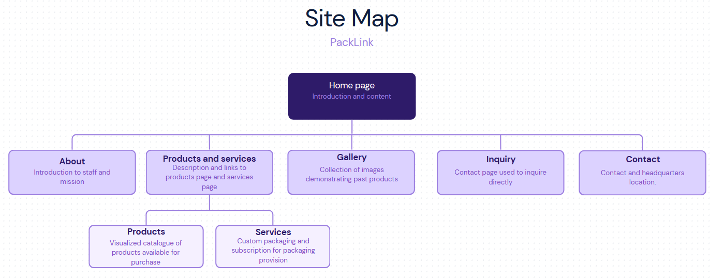
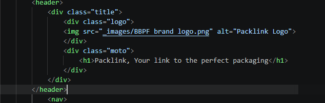

# Project Title:
Creating a multipage website for PackLink

# Student Information
**_Student Name:_** Kenneth Simpson

**_Student Number:_** ST10529686

# Project Overview

## Project overview (POE part 1)
Utilizing HTML code to create a website comprised of multiple web pages.
This website will be used to advertise and sell products for the business name PackLink.

### Tech stack

|Technology|Purpose|
|-|-|
|HTML5|Page structure and content|
|CSS|Styling and layout|
|JavaScript|Interactivity and dynamic behavior|

## Project overview (POE part 2)
Implementing CSS styling to html web pages to be more presentable.

## Project overview (POE part 3)
Implementing JavaScript functions to improve user experience and give users interactive elements.

# Key Features and Functionality
- Custom packaging order section
- Navigation section

# Timeline
|Week|Milestone|
|-|-|
|week 1|Proposal|
|week 2|Framework|
|week 3|content|
|week 4|initial styling|
|week 5|refinement|
|week 6|compile|
|week 7|publish|

# Part 1 Details

# Sitemap

# Changelog
## POE part 1
## POE part 2
- added a div with the class "container" to all pages body
- gave nav links of the current page the class "currentpage"
- added a seperate link bar when in either products or services to navigate to the  other.
- added a   with the class "clearfix" to all pages between main and footer
-  changed the content of the header to a more manageble format
     

- added a clearfix br between about us images and paragraph
- added missing </footer> on some pages
- added more text content on enquiry page
- on products and services page added a   between descriptions and links
- changed products page from list to article
- added missing comments
## POE part 3
- added javascript functionality in the form of a lightbox function in the gallery page.
- added javascript functionality to all web pages in the form of a lass modified line.
- improved site map to more informative.
- added lightbox functions to products page
- added @media screen functionality to adjust elements to smaller screen size
- updated _private folder
- added robots.txt and Sitemap.xml

# References

ARKA PACKAGING,2023. *Arka - How to create custom packaging*.[online video] Available at: https://www.youtube.com/watch?v=N46Fl28lNKA (last accessed 31 august 2026)

Printitza, 2026. *Custom Packaging Printing in South Africa*. [online website] available at:https://printitza.co.za/custom-packaging/ (last accessed 31 August 2026)

Theprintshop, 2026. *Custom Product Packaging*. [online website] Available at:https://theprintshop.co.za/product/custom-packaging-box/ (last accessed 31 August 2026)

PackMojo, 2026. *Get Custom Packaging Today*. [online website] Available at:https://packmojo.com/?srsltid=AfmBOoolA3wMm2a3SiWtuJwZDNYRmHsh1_Y4eoyJXsqea25C-P8GOQ1x (last accessed 31 August)

Elnariz, s.a. *Friendly warm smiling business man, corporate executive, successful CEO, in suit with arms folded*. [Online image] Available at: https://stock.adobe.com/za/images/friendly-warm-smiling-business-man-corporate-executive-successful-ceo-in-suit-with-arms-folded/255505033 (last accessed 31 August 2026)

Elnariz, s.a. *Portrait of a handsome CEO smiling*. [Online image] Available at: https://stock.adobe.com/za/search/images?filters%5Bcontent_type%3A3d%5D=1&filters%5Bcontent_type%3Aaudio%5D=0&filters%5Bcontent_type%3Aillustration%5D=1&filters%5Bcontent_type%3Aphoto%5D=1&filters%5Bcontent_type%3Atemplate%5D=1&filters%5Bcontent_type%3Avideo%5D=1&filters%5Bcontent_type%3Azip_vector%5D=1&filters%5Bfree_collection%5D=0&filters%5Binclude_stock_enterprise%5D=0&filters%5Bis_editorial%5D=0&order=relevance&serie_id=77917361&asset_id=77917361 (last accessed 31 August 2026)

Elnariz, s.a. *Attractive CEO older business woman executive portrait pose, standing outside workplace downtown*. [Online image] Available at: https://stock.adobe.com/images/attractive-ceo-older-business-woman-executive-portrait-pose-standing-outside-workplace-downtown/276041549 (last accessed 31 August 2026)

rbe, s.a. Medium Hamper or Packaging Box 310x245x85mm – 3 Pack. [online image] availabe at: https://rbe.co.za/product/medium-hamper-or-packaging-box-3-pack/ (last accessed 1 october 2026)

Amazon, s.a. 3 Ply Brown Flap Corrugated Packaging Box 4X4X1.5 Paper Cardboard for Secure Shipping | Durable & Eco-Friendly Packaging (Pack of 10). [image online] availabe at: https://www.amazon.in/Packgenie-Corrugated-Packaging-Cardboard-Eco-Friendly/dp/B0FGNX8855?th=1 (last accessed 1 october 2026)
